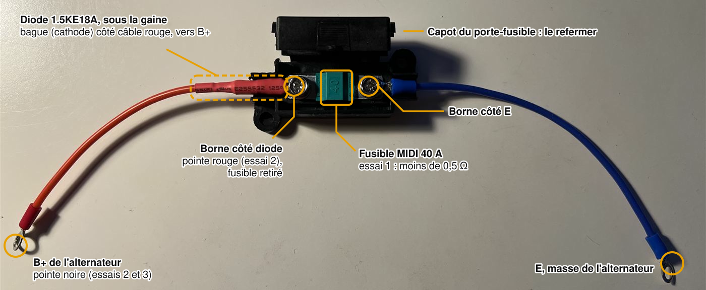

# 5.2 · Tester les écrêteurs de l'alternateur

*Fiche d'entretien. À faire chaque saison (avec la fiche 2.7), après tout incident (coupe-circuit moteur ouvert moteur tournant, fusible fondu, odeur de chaud près de l'alternateur), et sur la diode de rechange avant de l'embarquer.*

Deux modules identiques protègent l'alternateur contre les surtensions. Ils sont montés en parallèle sur l'alternateur, dans le compartiment moteur (derrière l'escalier de descente). Chacun relie la borne **B+** à la borne **E** (masse) :

**B+** → câble rouge → diode 1.5KE18A (bague côté B+) → porte-fusible MIDI, fusible 40 A → câble bleu → **E**

La diode est sous la gaine rouge, invisible : son sens se vérifie par les essais 2 et 3.

Matériel : un multimètre (positions diode ▶| et ohmmètre) et une clé pour les écrous du porte-fusible.

## Recto : les essais

### 1. Mettre hors tension

Moteur arrêté. Platine des coupe-circuits (contremarche de la descente) : coupe-circuit **moteur** (en haut à droite) sur **OFF**. B+ est sinon relié en permanence à la batterie moteur.

### 2. Chaque module, l'un après l'autre

Retirer le fusible du module : la diode est alors isolée du reste du circuit et peut se mesurer en place.

| # | Mesure | Attendu | Module 1 | Module 2 |
|---|---|---|---|---|
| 1 | Fusible seul, en ohmmètre | moins de 0,5 Ω | | |
| 2 | Position diode : pointe **rouge** sur la borne du porte-fusible **côté diode**, pointe **noire** sur **B+** | 0,4 à 0,8 V | | |
| 3 | Pointes inversées | « OL » | | |
| 4 | Gaine rouge de la diode : ni fendue, ni gonflée, ni noircie | conforme | | |
| 5 | Cosses et écrous : serrés, sans vert-de-gris ; câbles sans frottement sur le bloc | conforme | | |

Remonter le fusible, puis passer au module suivant.

### 3. Remettre sous tension

Coupe-circuit **moteur** sur **ON**.

### 4. Moteur tournant (fiche 2.3), au bout de 15 minutes

| # | Mesure | Attendu | Noté |
|---|---|---|---|
| 6 | Tension du démarreur (« Starter ») sur le SmartShunt (téléphone, VictronConnect), vers 1 500 tr/min | 13,8 à 14,8 V, **jamais plus de 15 V** | ___ V |
| 7 | Moteur arrêté : toucher les deux diodes | pas plus chaudes que les pièces voisines | |

### 5. Diode de rechange (sur sa cosse, rangée avec les rechanges)

| # | Mesure | Attendu | Noté |
|---|---|---|---|
| 8 | Position diode : rouge côté **sans bague**, noire côté **bague** | 0,4 à 0,8 V | |
| 9 | Pointes inversées | « OL » | |

## Verso : comprendre et réagir

**Comment ça protège.** En marche normale (14,4 V), la diode est bloquée et ne consomme rien. Au-delà d'environ 18 V, elle conduit et écrête la surtension. Si la surtension dure trop, elle se met en court-circuit, ce qui protège encore l'alternateur, puis le fusible isole le module. Le second module prend alors le relais : **un seul module en service suffit pour repartir**, mais il faut réparer le premier au port.

**Lire les résultats.**

| Constat | Cause | Que faire |
|---|---|---|
| Essai 1 : fusible coupé | la diode s'est mise en court-circuit | refaire les essais 2 et 3 : ils montreront 0,0 V dans les deux sens. Remplacer la diode par celle de rechange, poser un fusible neuf |
| Essais 2 et 3 : 0,0 V dans les deux sens | diode en court-circuit | remplacer la diode et vérifier le fusible |
| Essais 2 et 3 : « OL » dans les deux sens | diode coupée, ou cosse mal sertie | remplacer la diode ; si la diode neuve fait pareil, refaire la cosse |
| Essai 2 « OL », essai 3 entre 0,4 et 0,8 V | **diode montée à l'envers** | la retourner avant de remettre le fusible : à l'envers, elle court-circuite l'alternateur |
| Essai 6 : plus de 15 V | régulateur de l'alternateur en défaut | arrêter le moteur. Les diodes vont conduire, chauffer, puis claquer |
| Essai 7 : une diode chaude | elle conduit déjà en charge normale : seuil abaissé | la remplacer |

Après tout remplacement, racheter une diode 1.5KE18A et un fusible MIDI 40 A de rechange.

**Limite des essais 2 et 3.** Le multimètre ne vérifie que le sens direct (0,6 V) et l'absence de court-circuit. Ils ne mesurent pas le seuil d'environ 18 V : une diode abîmée qui conduirait trop tôt passe ces deux essais. Les essais 6 et 7, moteur tournant, la repèrent, car elle chauffe en charge.

**Essai du seuil, si l'on dispose d'un testeur adapté.** Il faut un multimètre ou un testeur de composants qui mesure les diodes Zener jusqu'à 20 V au moins (vérifier sur sa notice). Une position diode ordinaire n'envoie que 2 à 3 V. Cathode (bague, ou cosse B+ du module) sur le + du testeur. Attendu : **17,1 à 18,9 V**. Entre 15 et 17 V, la diode est dégradée : à remplacer.

**Ne jamais ouvrir le coupe-circuit moteur moteur tournant** : c'est justement la surtension contre laquelle ces modules protègent, et elle les use (fiche 2.3).
